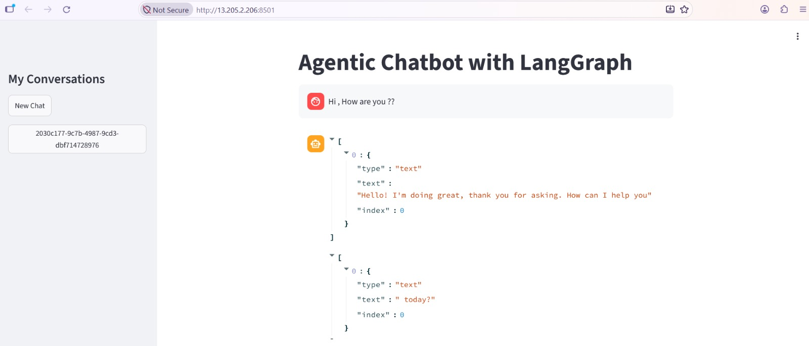

# Agentic Chatbot Deployment on AWS

A practical end-to-end deployment of a LangGraph-based Agentic AI
Chatbot using Docker, Amazon ECR, AWS CodeBuild, AWS CodePipeline,
Amazon ECS, and AWS Fargate.



> **Implementation notes**
>
> -   AWS CodeCommit was used as the CodePipeline source in this
>     practice project to learn the AWS-native source integration. If
>     the application source is hosted on GitHub, configure the
>     CodePipeline Source stage to use GitHub through AWS
>     CodeConnections instead.
> -   An Application Load Balancer (ALB) is recommended for a stable
>     application endpoint. It was intentionally not created in this
>     practice deployment because it introduces additional AWS charges.
>     The application was accessed directly through the Fargate task's
>     public IP and port `8501`. A task's public IP can change when ECS
>     replaces that task.

------------------------------------------------------------------------

## 1. Project Overview

This project demonstrates how to containerize and deploy an Agentic AI
chatbot to AWS and automate deployments using a CI/CD pipeline.

The application uses:

-   **Streamlit** for the browser-based user interface.
-   **LangGraph** to orchestrate the agent workflow.
-   **Google Gemini** for language-model functionality.
-   **Tavily** for web-search functionality.
-   **FAISS** for local vector similarity search used by the RAG
    workflow.
-   **Docker** to package the application and its dependencies.
-   **Amazon ECR** to store Docker images.
-   **AWS CodeBuild** to build and push images.
-   **AWS CodePipeline** to coordinate the deployment workflow.
-   **Amazon ECS with AWS Fargate** to run the container.
-   **Amazon CloudWatch Logs** to collect container logs.

### Project goals

1.  Package the chatbot into a Docker image.
2.  Store the image in a private ECR repository.
3.  Build a new image when source code changes.
4.  Push the image to ECR with a revision-based tag.
5.  Generate `imagedefinitions.json` for the ECS deployment action.
6.  Update the ECS service through CodePipeline.
7.  Run the application on Fargate without managing EC2 instances.
8.  Inspect application logs through CloudWatch.

------------------------------------------------------------------------

## 2. Architecture

### Architecture implemented for this practice project

``` text
Developer
   |
   | Push code
   v
AWS CodeCommit (master branch)
   |
   v
AWS CodePipeline
   |
   +--> Source stage
   |
   +--> Build stage: AWS CodeBuild
   |       |
   |       +--> Build Docker image
   |       +--> Tag image
   |       +--> Authenticate to ECR
   |       +--> Push image to ECR
   |       +--> Create imagedefinitions.json
   |
   v
Amazon ECR
   |
   v
Deploy stage: Amazon ECS action
   |
   v
Amazon ECS cluster
   |
   v
AWS Fargate task
   |
   +--> Streamlit application on TCP port 8501
   |
   +--> Container logs to CloudWatch Logs
   |
   v
Browser: http://<TASK_PUBLIC_IP>:8501
```

### Recommended production-style request path

``` text
User / Browser
      |
      v
Application Load Balancer
      |
      v
Target group (target type: IP, port: 8501)
      |
      v
ECS Fargate service
      |
      v
Fargate task running Streamlit
```

### Why add an Application Load Balancer?

A Fargate task uses an elastic network interface. When ECS replaces a
task during a deployment or after a task failure, the replacement task
can receive a different IP address. A URL containing the old task IP is
therefore not a reliable permanent endpoint.

An ALB provides a stable DNS name and forwards requests to healthy task
IP addresses registered in its target group. For this HTTP-based
Streamlit application, an ALB is a suitable production-style entry
point.

**Why is the ALB not included in this implementation?**

The ALB was intentionally skipped to reduce the cost of this learning
environment. An ALB can incur hourly and load-balancing capacity
charges. Direct task-IP access was used for testing instead.

> For production, add an ALB, configure HTTPS with a domain name and an
> AWS Certificate Manager certificate, and restrict the task security
> group so that port `8501` accepts traffic only from the ALB security
> group.

------------------------------------------------------------------------

## 3. Technology Stack

  Technology               Purpose
  ------------------------ -----------------------------------------------------------
  Python                   Application programming language
  Streamlit                Web interface
  LangGraph                Agent workflow orchestration
  Google Gemini            Language-model integration
  Tavily                   Web search
  FAISS                    Local vector search for RAG
  SQLite                   Local checkpoint/state storage in the current application
  Docker                   Containerization
  Amazon ECR               Private Docker image registry
  AWS CodeCommit           Source repository used in this practice pipeline
  AWS CodeBuild            Builds and pushes the Docker image
  AWS CodePipeline         Automates Source, Build, and Deploy stages
  Amazon ECS               Manages the service and tasks
  AWS Fargate              Runs containers without managing EC2 instances
  Amazon CloudWatch Logs   Container log collection

------------------------------------------------------------------------

## 4. Repository Structure

The project directory contains the application and deployment files. The
exact folders may vary depending on your implementation.

``` text
Agentic-Chatbot-using-LangGraph/
│
├── app.py                  # Streamlit frontend and chat interface
├── backend.py              # LangGraph workflow, tools, model, and RAG logic
├── requirements.txt        # Python package dependencies
├── Dockerfile              # Instructions for building the container image
├── .dockerignore           # Excludes files from the Docker build context
├── .gitignore              # Excludes local and sensitive files from Git
├── buildspec.yml           # AWS CodeBuild build instructions
├── README.md               # Project documentation
│
├── faiss_db/               # Local FAISS data, if generated by the app
├── chatbot.db              # Local SQLite database, if generated by the app
└── .env                    # Local API keys; must not be committed
```

--- Runs the Streamlit frontend. It displays the chat
    interface, accepts user messages, streams responses, and handles
    supported interactions such as document uploads.
-   **`backend.py`** --- Implements the backend logic, including the
    LangGraph workflow, model integration, tools, retrieval logic, and
    checkpointing.
-   **`requirements.txt`** --- Lists the Python packages that must be
    installed for the application to run.
-   **`Dockerfile`** --- Defines the base image, system packages, Python
    dependencies, application files, exposed port, and container startup
    command.
-   **`buildspec.yml`** --- Defines the commands CodeBuild executes to
    build the Docker image, push it to ECR, and create the ECS image
    definitions file.
-   **`.env`** --- Stores local development credentials. It must never
    be committed to source control or copied into the container image.

------------------------------------------------------------------------

## 5. Prerequisites

Before starting, prepare:

-   An AWS account with permissions to create the required resources.
-   AWS Region: `ap-south-1` (Mumbai) for this implementation.
-   Docker installed locally.
-   Git installed.
-   The chatbot application source code.
-   API keys required by the integrations enabled in the application.
-   An ECR repository.
-   An ECS cluster, task definition, and service.
-   A CodeBuild project.
-   A CodePipeline pipeline.

AWS console labels can change. Refer to the official AWS documentation
linked at the end of this README if a console screen differs.

------------------------------------------------------------------------

## 6. Application Environment Variables and Secrets

The application may require the following environment variables,
depending on which integrations are enabled:

  -----------------------------------------------------------------------
  Variable                            Purpose
  ----------------------------------- -----------------------------------
  `GOOGLE_API_KEY`                    Authenticates requests to Google
                                      Gemini

  `TAVILY_API_KEY`                    Authenticates requests to Tavily
                                      search

  `OPENWEATHER_API_KEY`               Used by the weather integration, if
                                      enabled

  `ALPHA_VANTAGE_API_KEY`             Used by the financial-data
                                      integration, if enabled

  LangSmith variables                 Optional tracing and observability
                                      configuration, if enabled
  -----------------------------------------------------------------------

Use the exact variable names referenced by your Python code.

### Local `.env` example

``` env
GOOGLE_API_KEY=replace-with-your-key
TAVILY_API_KEY=replace-with-your-key
OPENWEATHER_API_KEY=replace-with-your-key
ALPHA_VANTAGE_API_KEY=replace-with-your-key
```

Replace the example values locally. Never put real credentials in this
README.

### Security considerations

-   Do not commit `.env` to GitHub or CodeCommit.
-   Do not hardcode API keys in Python source code or the Dockerfile.
-   Do not include credentials in screenshots, logs, or public
    documentation.
-   Rotate any credential that has been exposed.
-   This practice deployment used task-definition environment variables
    for demonstration. Plain-text environment variables are not the
    recommended production approach.
-   For production, store credentials in AWS Secrets Manager or Systems
    Manager Parameter Store and configure the ECS task definition to
    retrieve them securely.
-   Grant the task execution role only the permissions needed to
    retrieve the configured secrets.

------------------------------------------------------------------------

## 7. Docker Configuration

### Dockerfile

The Dockerfile is maintained separately in the project repository. Refer to the [`Dockerfile`](./Dockerfile) for the base image, system dependencies, Python dependency installation, application copy instructions, exposed port, and Streamlit startup command. The application listens on container port `8501`.

### `.dockerignore`

Create `.dockerignore` in the project root:

``` text
.env
.env.*
.git
.gitignore
__pycache__/
*.pyc
*.pyo
*.pyd
.venv/
venv/
```

This prevents local secrets, Git metadata, and common Python
cache/virtual-environment files from being sent as part of the Docker
build context.

Review the list before using it. If the application requires a data file
at runtime, do not exclude that file without providing another way to
make it available.

### `.gitignore`

At minimum, exclude local secrets and generated state:

``` text
.env
.env.*
.venv/
venv/
__pycache__/
*.py[cod]
chatbot.db
faiss_db/
```

If the application needs a prebuilt FAISS index, design a durable way to
provide it instead of relying on a local directory that may not exist in
a replacement task.

------------------------------------------------------------------------

## 8. Run the Application Locally

From the project directory, install the Python dependencies:

``` bash
python -m pip install -r requirements.txt
```

Start Streamlit:

``` bash
streamlit run app.py
```

Open the local URL printed by Streamlit, normally:

``` text
http://localhost:8501
```

Test the chatbot and the integrations enabled in your application before
containerizing it.

------------------------------------------------------------------------

## 9. Build and Test the Docker Image Locally

Build the image from the project root:

``` bash
docker build -t agentic-chatbot:local .
```

This command reads the Dockerfile and builds an image named
`agentic-chatbot` with the tag `local`.

Check the local image:

``` bash
docker images
```

Run the container:

``` bash
docker run --rm -p 8501:8501 \
  -e GOOGLE_API_KEY="your-key" \
  -e TAVILY_API_KEY="your-key" \
  agentic-chatbot:local
```

Add any other environment variables required by your enabled
integrations. Use your own credentials; do not paste real keys into
source control.

The `-p 8501:8501` option maps host port 8501 to container port 8501.
Open:

``` text
http://localhost:8501
```

Stop the container with `Ctrl+C`.

------------------------------------------------------------------------

## 10. Create the Amazon ECR Repository

Amazon Elastic Container Registry (ECR) is the private registry where
the Docker images are stored.

1.  Open Amazon ECR in the AWS Console.

2.  Select Region `ap-south-1`.

3.  Choose **Create repository**.

4.  Select **Private**.

5.  Enter the repository name:

    ``` text
    agentic-ai-repo
    ```

6.  Create the repository.

The repository URI has this format:

``` text
<AWS_ACCOUNT_ID>.dkr.ecr.ap-south-1.amazonaws.com/agentic-ai-repo
```

Replace `<AWS_ACCOUNT_ID>` with the account ID of your own AWS account.

### Why ECR?

CodeBuild pushes the container image to ECR. ECS then pulls that image
when it starts a task or deploys a new application version.

------------------------------------------------------------------------

## 11. Create the ECS Cluster

Amazon ECS manages the service and tasks. AWS Fargate provides the
compute capacity for the containers.

1.  Open Amazon ECS.

2.  Go to **Clusters**.

3.  Choose **Create cluster**.

4.  Enter the cluster name:

    ``` text
    agentic-ai-cluster
    ```

5.  Select the Fargate/serverless option where the console asks for
    infrastructure.

6.  Create the cluster.

The cluster is a logical grouping for ECS services and tasks. Creating
it does not start the chatbot by itself.

------------------------------------------------------------------------

## 12. Create the ECS Task Definition

A task definition is the configuration blueprint ECS uses to run the
container.

The task definition family used in this project is:

``` text
agentic-chatbot-task
```

The practice configuration was:

  Setting                     Practice value
  --------------------------- ----------------------------------------
  Launch type compatibility   AWS Fargate
  Operating system            Linux
  CPU architecture            X86_64
  CPU                         1 vCPU
  Memory                      2 GiB
  Container name              `agentic-chatbot`
  Container port              `8501`
  Protocol                    TCP
  Image                       ECR image URI
  Task execution role         `ecsTaskExecutionRole`
  Task role                   None configured in this practice setup
  CloudWatch log group        `/ecs/agentic-chatbot`

These are the values used in this practice environment, not universal
sizing recommendations. Adjust CPU and memory based on actual
application usage.

### Container image

Set the image to the ECR image URI, for example:

``` text
<AWS_ACCOUNT_ID>.dkr.ecr.ap-south-1.amazonaws.com/agentic-ai-repo:latest
```

During pipeline deployment, the ECS deploy action uses the image URI in
`imagedefinitions.json` to deploy the newly built image.

### Container port

Set the container port to:

``` text
8501
```

This must match the Streamlit port configured in the Dockerfile.

### Environment variables

Add the environment variable names required by the backend. The practice
deployment used task-definition environment variables for the demo.

Do not add real API keys to this README or commit them to source
control. For production, use the task definition's Secrets configuration
with Secrets Manager or Parameter Store.

### Task execution role

The task execution role is used by the ECS/Fargate agent for operations
such as pulling an image from ECR and sending logs to CloudWatch.

The role used here is:

``` text
ecsTaskExecutionRole
```

For a standard ECR image-pull and CloudWatch Logs setup, the AWS-managed
`AmazonECSTaskExecutionRolePolicy` is commonly attached. Add other
permissions only when the task startup configuration requires them.

### Task execution role vs. task role

-   **Task execution role:** Used by ECS/Fargate infrastructure to pull
    images, deliver logs, and retrieve configured secrets.
-   **Task role:** Used by the application code inside the container
    when it calls AWS services.

The task role was not configured in this practice setup. If the
application later needs to access S3, DynamoDB, or other AWS services,
create a separate least-privilege task role for those application
permissions.

### CloudWatch logging

Configure the container to use the `awslogs` log driver and the log
group:

``` text
/ecs/agentic-chatbot
```

This sends the container's standard output and error streams to
CloudWatch Logs. Ensure the log group exists or is configured to be
created and that the execution role has the required logging
permissions.

------------------------------------------------------------------------

## 13. Create the ECS Service

An ECS service maintains the desired number of running tasks and
replaces tasks when they stop or when a new deployment is rolled out.

1.  Open the ECS cluster `agentic-ai-cluster`.

2.  Choose **Create service**.

3.  Select the Fargate launch type/capacity option.

4.  Select task definition family `agentic-chatbot-task`.

5.  Enter the service name:

    ``` text
    agentic-chatbot-task-service
    ```

6.  Set desired task count to `1` for this practice deployment.

7.  Select the VPC and subnets.

8.  Configure the task security group.

9.  Enable public IP assignment because this practice setup accesses the
    task directly without an ALB.

10. Create the service.

The service name and desired count may differ in another environment.

### Security group for direct task access

For this practice setup, the task security group needs an inbound TCP
rule for port `8501`.

For testing, restrict the source to your current public IP in CIDR
notation:

``` text
<YOUR_PUBLIC_IP>/32
```

This is safer than allowing access from every IPv4 address.

If you later add an ALB, change the design:

-   The ALB security group should allow inbound HTTP/HTTPS from intended
    client networks.
-   The task security group should allow inbound TCP `8501` only from
    the ALB security group.
-   Do not leave the task port publicly accessible when the ALB is the
    intended entry point.

### Access the application

After the ECS service has a running task:

1.  Open the ECS service.

2.  Select the running task.

3.  Open its networking details.

4.  Find the task public IP.

5.  Open the following address in a browser:

    ``` text
    http://<TASK_PUBLIC_IP>:8501
    ```

The page should load if the task is running, Streamlit is listening on
`0.0.0.0:8501`, the subnet has the required network route, and the
security group allows your client traffic.

**Important:** The task public IP is not a permanent endpoint. It can
change when ECS replaces the task.

------------------------------------------------------------------------

## 14. Configure AWS CodeBuild

AWS CodeBuild builds the Docker image and pushes it to ECR.

### Create a CodeBuild project

1.  Open AWS CodeBuild.

2.  Choose **Create build project**.

3.  Enter a project name, for example:

    ``` text
    agentic-ai-build
    ```

4.  Configure the source integration used by the pipeline.

5.  Select a managed Linux build environment suitable for Docker builds.

6.  Enable **Privileged** mode in the build environment. Docker builds
    inside CodeBuild generally require privileged mode when using the
    Docker daemon.

7.  Select or create the CodeBuild service role.

8.  Configure the project to use the repository's `buildspec.yml`.

9.  Create the project.

### CodeBuild role permissions

The CodeBuild service role needs permission to:

-   Obtain an ECR authorization token.
-   Authenticate Docker to ECR.
-   Upload image layers.
-   Publish image manifests to the specific ECR repository.
-   Write build logs to CloudWatch Logs.

Use least-privilege IAM permissions. Scope repository actions to the ECR
repository used by this project rather than granting broad administrator
access.

------------------------------------------------------------------------

## 15. Configure `buildspec.yml`

The buildspec file tells CodeBuild which commands to run and which files
to publish as build artifacts.

Use the following buildspec. Change the Region, ECR repository, or
container name if you use different resource names.

``` yaml
version: 0.2

env:
  variables:
    AWS_DEFAULT_REGION: ap-south-1
    IMAGE_REPO_NAME: agentic-ai-repo

phases:
  pre_build:
    commands:
      - echo "Logging in to Amazon ECR"
      - ACCOUNT_ID=$(aws sts get-caller-identity --query Account --output text)
      - REPOSITORY_URI=$ACCOUNT_ID.dkr.ecr.$AWS_DEFAULT_REGION.amazonaws.com/$IMAGE_REPO_NAME
      - IMAGE_TAG=$CODEBUILD_RESOLVED_SOURCE_VERSION
      - IMAGE_TAG=${IMAGE_TAG:0:7}
      - echo "Repository URI is $REPOSITORY_URI"
      - echo "Image tag is $IMAGE_TAG"
      - aws ecr get-login-password --region $AWS_DEFAULT_REGION | docker login --username AWS --password-stdin $REPOSITORY_URI

  build:
    commands:
      - echo "Building Docker image"
      - docker build -t $REPOSITORY_URI:$IMAGE_TAG .
      - docker tag $REPOSITORY_URI:$IMAGE_TAG $REPOSITORY_URI:latest

  post_build:
    commands:
      - echo "Pushing Docker images to ECR"
      - docker push $REPOSITORY_URI:$IMAGE_TAG
      - docker push $REPOSITORY_URI:latest
      - echo "Creating ECS image definitions file"
      - |
        printf '[{"name":"agentic-chatbot","imageUri":"%s"}]' "$REPOSITORY_URI:$IMAGE_TAG" > imagedefinitions.json
        cat imagedefinitions.json
      - echo "Docker image pushed and image definitions generated successfully"

artifacts:
  files:
    - imagedefinitions.json
```

### Line-by-line explanation

#### `version: 0.2`

Specifies the buildspec format version used by CodeBuild.

#### `env`

Defines environment variables available to the build commands.

#### `variables`

-   `AWS_DEFAULT_REGION: ap-south-1` --- sets the AWS Region used by the
    AWS CLI commands.
-   `IMAGE_REPO_NAME: agentic-ai-repo` --- identifies the ECR repository
    where the image is stored.

These are configuration values, not application API keys. Do not store
secrets in the buildspec.

#### `phases`

Defines the ordered phases CodeBuild executes.

#### `pre_build`

This phase prepares the build environment and authenticates to ECR.

-   `echo "Logging in to Amazon ECR"` --- prints a status message in the
    build log.
-   `aws sts get-caller-identity ...` --- retrieves the AWS account ID
    of the identity used by the CodeBuild job.
-   `REPOSITORY_URI=...` --- constructs the full ECR repository URI from
    the account ID, Region, and repository name.
-   `IMAGE_TAG=$CODEBUILD_RESOLVED_SOURCE_VERSION` --- obtains the
    source revision associated with this build.
-   `IMAGE_TAG=${IMAGE_TAG:0:7}` --- uses the first seven characters as
    a shorter image tag.
-   The next two `echo` commands print the repository URI and image tag
    for troubleshooting.
-   `aws ecr get-login-password ...` --- obtains an ECR authentication
    token.
-   `docker login ...` --- logs Docker in to the ECR registry so the
    build can push the image.

A source-revision tag helps identify which code revision produced an
image. The `latest` tag is also updated for convenience, but unique
revision tags provide better traceability.

#### `build`

This phase creates and tags the image.

-   `docker build -t $REPOSITORY_URI:$IMAGE_TAG .` --- reads the
    Dockerfile in the current build directory and creates an image with
    the revision-based tag.
-   `docker tag ... $REPOSITORY_URI:latest` --- adds a `latest` tag to
    the same built image. It does not build a second image.

#### `post_build`

This phase pushes the image and prepares the deployment input.

-   `docker push $REPOSITORY_URI:$IMAGE_TAG` --- uploads the
    revision-tagged image to ECR.
-   `docker push $REPOSITORY_URI:latest` --- uploads/updates the
    `latest` tag in ECR.
-   The `echo` command prints a status message.
-   The `printf` command creates `imagedefinitions.json`.
-   `cat imagedefinitions.json` prints the generated file in the build
    log for verification.
-   The final `echo` prints a completion message.

The generated file has this structure:

``` json
[
  {
    "name": "agentic-chatbot",
    "imageUri": "<ECR_IMAGE_URI_WITH_TAG>"
  }
]
```

The `name` must exactly match the container name in the ECS task
definition. Here, that name is `agentic-chatbot`.

The `imageUri` is the full ECR image URI, including the revision tag
that CodeBuild just pushed.

#### `artifacts`

``` yaml
artifacts:
  files:
    - imagedefinitions.json
```

This tells CodeBuild to include `imagedefinitions.json` in the output
artifact. The native Amazon ECS deploy action in CodePipeline reads this
file to determine which container image to deploy.

If the file is missing, has the wrong container name, or is not included
in the output artifact, the ECS deployment action may fail or fail to
update the intended container.

------------------------------------------------------------------------

## 16. Configure AWS CodePipeline

CodePipeline automates the Source, Build, and Deploy stages.

The pipeline name used in this practice environment is:

``` text
agentic-ai-pipeline
```

The pipeline has three stages:

``` text
Source  -->  Build  -->  Deploy
```

### Stage 1: Source --- CodeCommit used for practice

The source provider used in this implementation is AWS CodeCommit.

Repository:

``` text
agentic-ai-repo
```

Branch:

``` text
master
```

CodePipeline retrieves the selected branch's source revision and passes
it to the next stage.

### Use GitHub as the source instead

If the project is stored on GitHub, configure GitHub as the CodePipeline
source through AWS CodeConnections.

Typical configuration:

1.  Push the project to your GitHub repository.
2.  Open CodePipeline and edit the Source stage.
3.  Choose the GitHub source integration available through AWS
    CodeConnections.
4.  Create or select a connection.
5.  Authorize the connection to access the intended GitHub account or
    organization.
6.  Select the repository and branch.
7.  Save the pipeline and verify that the Source stage can retrieve the
    source.

**Why does this project use CodeCommit in the documented
implementation?**

CodeCommit was used for practice to understand how an AWS-native source
repository integrates with CodePipeline. It is not a requirement of the
chatbot or ECS architecture. A GitHub-hosted project can use GitHub as
the pipeline source instead.

Choose the repository that should trigger deployments. Do not configure
both sources unless you intentionally need a multi-source pipeline.

### Stage 2: Build --- CodeBuild

Select the CodeBuild project created earlier.

CodePipeline passes the source artifact to CodeBuild. CodeBuild then:

1.  Reads the source files and Dockerfile.
2.  Builds the Docker image.
3.  Creates a revision-based image tag.
4.  Authenticates Docker to ECR.
5.  Pushes the revision-tagged image to ECR.
6.  Updates the `latest` tag.
7.  Creates `imagedefinitions.json`.
8.  Publishes the image definitions file as an output artifact.

### Stage 3: Deploy --- Amazon ECS

Choose the native **Amazon ECS** deploy action.

Configure the deployment action with:

  Setting                  Value used in this project
  ------------------------ --------------------------------
  Region                   `ap-south-1`
  ECS cluster              `agentic-ai-cluster`
  ECS service              `agentic-chatbot-task-service`
  Input artifact           CodeBuild output artifact
  Image definitions file   `imagedefinitions.json`

The image name in `imagedefinitions.json` must match the container name
in the ECS task definition:

``` text
agentic-chatbot
```

The ECS deployment action reads the new image URI and updates the
service to deploy that image. ECS then starts replacement tasks and
retires old tasks as the service deployment progresses.

> This is the standard Amazon ECS deployment action in CodePipeline. It
> is not the same as configuring an AWS CodeDeploy blue/green
> deployment.

### CodePipeline IAM permissions

The CodePipeline service role needs permission to access its S3 artifact
store and invoke the configured source, build, and deploy actions.

Depending on the pipeline configuration, the role may need:

-   S3 bucket and object access for the pipeline artifact store.
-   Permission to use the configured source connection.
-   Permission to start and inspect the CodeBuild project.
-   ECS permissions required by the ECS deployment action.
-   Narrowly scoped `iam:PassRole` permission for task roles referenced
    by the task definition, where required.

The practice pipeline initially encountered an S3 artifact access
permission error. The pipeline role's access to the artifact bucket was
corrected, after which the pipeline progressed successfully.

Do not copy IAM policies from another account without checking the
bucket ARN, Region, ECS resources, task roles, and exact actions
required by your pipeline. Follow least privilege.

------------------------------------------------------------------------

## 17. End-to-End CI/CD Workflow

Once configured, the automated workflow is:

1.  A developer updates the application source code.
2.  The developer pushes the change to the configured repository and
    branch.
3.  CodePipeline detects the source revision.
4.  CodePipeline starts the CodeBuild stage.
5.  CodeBuild builds a new Docker image.
6.  CodeBuild tags the image using the source revision.
7.  CodeBuild pushes the image to Amazon ECR.
8.  CodeBuild creates `imagedefinitions.json`.
9.  CodeBuild publishes the file as a build artifact.
10. CodePipeline starts the Amazon ECS deploy action.
11. The deploy action reads the image definitions file.
12. The ECS service is updated to use the new image.
13. ECS launches replacement Fargate task(s) and retires old task(s) as
    the deployment proceeds.
14. The new container starts Streamlit on port `8501`.
15. The container writes its application output to CloudWatch Logs.

This automates image building, publishing, and ECS service deployment
whenever a new source revision enters the pipeline.

------------------------------------------------------------------------

## 18. Monitoring and Troubleshooting

### CodePipeline

Open the pipeline and inspect the latest execution.

-   **Source stage failure:** Check the repository, branch, connection
    authorization, and source permissions.
-   **Build stage failure:** Open the CodeBuild logs and find the first
    failing command.
-   **Deploy stage failure:** Check the ECS service, task definition,
    image definitions file, and pipeline role permissions.

### CodeBuild logs

Open the CodeBuild project, select the build execution, and inspect its
CloudWatch log stream.

Common causes of build failure include:

-   Docker privileged mode is not enabled.
-   The ECR repository name or Region is incorrect.
-   The CodeBuild role cannot push to ECR.
-   A Python dependency fails to install.
-   A required file is missing from the Docker build context.

### ECS service events

Open:

``` text
Amazon ECS
  -> Clusters
  -> agentic-ai-cluster
  -> Services
  -> agentic-chatbot-task-service
```

Inspect service events and deployment status. ECS events often provide
the reason a task could not start or a deployment could not stabilize.

### Stopped task details

If a task stops:

1.  Open the ECS service.
2.  Open the **Tasks** tab.
3.  Select the stopped task.
4.  Inspect the stopped reason and container exit details.

### CloudWatch Logs

Open the CloudWatch log group:

``` text
/ecs/agentic-chatbot
```

Check the application startup output. Streamlit should listen on:

``` text
0.0.0.0:8501
```

If the container starts but the browser cannot access it, check:

-   Whether the ECS task is running.
-   Whether public IP assignment is enabled for direct access.
-   Whether the task security group allows inbound TCP port `8501` from
    your client IP.
-   Whether the subnet has a route to an Internet Gateway.
-   Whether network ACL rules allow the traffic.
-   Whether Streamlit is listening on `0.0.0.0` and the expected port.

A browser timeout does not automatically mean the application crashed.
Verify task status and logs before changing the application.

------------------------------------------------------------------------

## 19. Production Improvements and Design Considerations

This is a learning deployment. Consider the following improvements
before using it for production traffic or important user data.

### 19.1 Add an Application Load Balancer

**Practice configuration:** Browser connects directly to the Fargate
task's public IP on port `8501`.

**Limitation:** A replacement task may receive a different IP address.

**Recommended design:**

1.  Create an internet-facing ALB in suitable public subnets across at
    least two Availability Zones.
2.  Create a target group with target type `IP`.
3.  Configure the target group to forward to port `8501`.
4.  Create an HTTP listener that forwards requests to the target group.
5.  Attach the target group to the ECS service, using container name
    `agentic-chatbot` and container port `8501`.
6.  Allow inbound HTTP/HTTPS traffic on the ALB security group.
7.  Allow task port `8501` only from the ALB security group.
8.  Use the ALB DNS name as the application endpoint.
9.  Add a domain name and HTTPS listener with an ACM certificate when
    ready.

**Cost decision:** The ALB was not created in this project because it
adds charges and the goal was to keep the practice environment's cost
lower. This is a deliberate cost trade-off, not a production
recommendation.

### 19.2 Use GitHub as the pipeline source

The current practice pipeline uses CodeCommit. If the project is
maintained in GitHub, connect the GitHub repository to CodePipeline
through AWS CodeConnections and select it as the Source stage provider.

### 19.3 Store secrets securely

Move API keys from plain-text task-definition environment variables to
AWS Secrets Manager or Systems Manager Parameter Store. Give the task
execution role access only to the secrets required by the application.
Rotate any credentials that were exposed.

### 19.4 Make application state durable

The current application uses local SQLite checkpointing and a local
FAISS store. Do not treat a Fargate container's local filesystem as
durable storage. A replacement task may not have the previous task's
local state.

For a production design, evaluate:

-   **Amazon RDS for PostgreSQL** for durable relational data and a
    compatible LangGraph checkpoint persistence integration.
-   **Amazon S3** for uploaded documents and durable object storage.
-   **Amazon OpenSearch Service** or **PostgreSQL with pgvector** for a
    durable vector-search layer, depending on the application's scale
    and requirements.

Choose the persistence architecture based on data model, concurrency,
recovery, and cost requirements.

### 19.5 Add HTTPS

Use an ALB HTTPS listener, a domain name, and an AWS Certificate Manager
certificate. Avoid sending sensitive application traffic over plain HTTP
in production.

### 19.6 Improve availability and scaling

For production, evaluate:

-   More than one ECS task across Availability Zones.
-   ECS service auto scaling.
-   ALB target-group health checks.
-   Container health checks.
-   Deployment alarms and rollback settings.
-   CPU and memory sizing based on observed utilization.

### 19.7 Improve observability

Consider CloudWatch metrics and alarms, structured application logs,
request/error monitoring, and tracing for backend calls. LangSmith
tracing can also be evaluated if enabled and appropriate for the
application's data-handling requirements.

------------------------------------------------------------------------

## 20. Cost Awareness and Cleanup

AWS resources may continue to incur charges while they exist or are
running. Review the resources created for this project and delete those
that are no longer required.

Potential chargeable resources include:

-   Fargate task runtime and allocated CPU/memory.
-   An Application Load Balancer, if created.
-   ECR image storage.
-   CloudWatch log ingestion and storage.
-   Data transfer and public IPv4 usage where applicable.
-   Other AWS services enabled by the project.

The ALB was deliberately omitted from this practice deployment to avoid
its additional charges.

### Cleanup checklist

When testing is complete, review and remove resources in a
dependency-aware order:

1.  Stop or delete the ECS service.
2.  Delete the ECS cluster after its services and tasks are removed.
3.  Deregister unused task-definition revisions if appropriate.
4.  Delete unused ECR images or the repository if it is no longer
    required.
5.  Disable or delete the CodePipeline pipeline if it is no longer
    required.
6.  Delete the CodeBuild project if it is no longer required.
7.  Review and delete unused CloudWatch log groups if the logs are no
    longer needed.
8.  Review IAM roles and policies; delete only those created exclusively
    for this project and no longer in use.
9.  Review the CodePipeline artifact S3 bucket and its contents. Delete
    it only if it is not shared or used by another pipeline.
10. Check AWS Billing after cleanup for remaining resources or charges.

Do not delete shared VPCs, subnets, security groups, IAM roles, buckets,
or other resources until you have confirmed that no other workload
depends on them.

------------------------------------------------------------------------

## 21. Key Learnings

This project provided hands-on practice with:

-   Containerizing a Python application using Docker.
-   Understanding Dockerfile instructions and container port mapping.
-   Publishing Docker images to Amazon ECR.
-   Configuring CodeBuild to build and push images.
-   Tagging images using source revisions.
-   Generating `imagedefinitions.json` for the ECS deployment action.
-   Connecting Source, Build, and Deploy stages in CodePipeline.
-   Running containers on ECS Fargate.
-   Understanding ECS clusters, task definitions, services, and tasks.
-   Configuring task execution roles and security groups.
-   Viewing container logs in CloudWatch.
-   Troubleshooting pipeline IAM permissions and ECS networking.
-   Understanding why a Fargate task public IP is not a stable
    application endpoint.
-   Comparing a cost-conscious practice deployment with a more
    production-oriented ALB design.

------------------------------------------------------------------------

## 22. Official Documentation

-   [Amazon ECS
    documentation](https://docs.aws.amazon.com/AmazonECS/latest/developerguide/Welcome.html)
-   [AWS Fargate
    documentation](https://docs.aws.amazon.com/AmazonECS/latest/developerguide/AWS_Fargate.html)
-   [Amazon ECR
    documentation](https://docs.aws.amazon.com/AmazonECR/latest/userguide/what-is-ecr.html)
-   [AWS CodeBuild
    documentation](https://docs.aws.amazon.com/codebuild/latest/userguide/welcome.html)
-   [AWS CodeBuild buildspec
    reference](https://docs.aws.amazon.com/codebuild/latest/userguide/build-spec-ref.html)
-   [AWS CodePipeline
    documentation](https://docs.aws.amazon.com/codepipeline/latest/userguide/welcome.html)
-   [CodePipeline Amazon ECS deploy
    action](https://docs.aws.amazon.com/codepipeline/latest/userguide/action-reference-ECS.html)
-   [AWS CodeConnections
    documentation](https://docs.aws.amazon.com/dtconsole/latest/userguide/welcome-connections.html)
-   [Application Load Balancer
    documentation](https://docs.aws.amazon.com/elasticloadbalancing/latest/application/introduction.html)
-   [AWS Secrets Manager
    documentation](https://docs.aws.amazon.com/secretsmanager/latest/userguide/intro.html)
-   [Amazon CloudWatch Logs
    documentation](https://docs.aws.amazon.com/AmazonCloudWatch/latest/logs/WhatIsCloudWatchLogs.html)

------------------------------------------------------------------------

## 23. Project Repository

**GitHub repository:**
`https://github.com/<your-username>/<your-repository>`

Replace the placeholder with the actual GitHub repository URL before
publishing this README.

If you find this project useful, feel free to explore the
implementation, raise an issue, or suggest an improvement.
